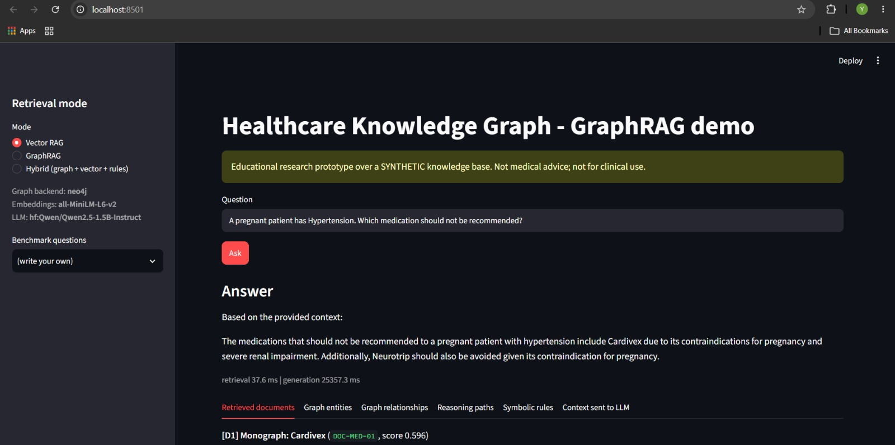
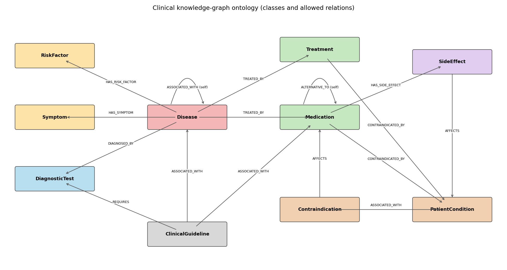

# Healthcare Neuro-Symbolic GraphRAG

A prototype combining a knowledge graph, vector retrieval, symbolic rules, and an LLM for multi-hop question answering over synthetic healthcare data.

The system combines:

* an ontology and a Neo4j knowledge graph
* vector retrieval with FAISS
* graph-based retrieval and multi-hop traversal
* deterministic symbolic rules
* LLM-based answer generation
* evidence retrieval and reasoning traces

> **Disclaimer.** This is an educational/research prototype and is not a medical system. All data is synthetic. Medication names are invented and clinical statements are fictional. No real patient data is used. The project does not make any claim of clinical validity or performance.

---

## 1. Motivation

Vector RAG works well when the information needed to answer a question is contained in a few relevant text chunks. It becomes less suitable when the answer requires combining several facts stored in different documents.

Knowledge graphs make relations between entities explicit, while symbolic rules can derive additional facts from those relations. LLMs are then used for language understanding and answer generation.

This project explores how these components can be combined for multi-hop question answering.

## 2. Problem statement

Given a question such as:

> "Which treatment for Heart Failure should not be recommended for a patient with Severe Renal Impairment, and which alternative needs additional review?"

the system retrieves relevant documents and graph relations, applies the symbolic rules, and generates an answer together with the evidence used.

## 3. Research question

> **Can combining a Knowledge Graph with vector retrieval improve multi-hop question answering compared with a conventional vector-only RAG system?**

Three retrieval modes are implemented:

| Mode           | Retrieval                                  | Reasoning                         | Description                                                           |
| -------------- | ------------------------------------------ | --------------------------------- | --------------------------------------------------------------------- |
| **Vector RAG** | FAISS top-k over document chunks           | None                              | Retrieves text chunks based on semantic similarity.                   |
| **GraphRAG**   | Entity linking + multi-hop graph traversal | Graph paths                       | Retrieves relevant relations by traversing the knowledge graph.       |
| **Hybrid**     | Vector + graph + symbolic rules            | Graph paths + deterministic rules | Combines document evidence, graph relations, and derived conclusions. |

## 4. Architecture

```text
                         User question
                               |
                  Question understanding
             (entity linking: names + aliases -> KG nodes)
                               |
        +----------------------+------------------------+
        |                      |                        |
        v                      v                        v
 Vector retrieval        Graph retrieval          Symbolic rules
 chunks -> embeddings    seeds -> bounded         deterministic rules
 -> FAISS top-k          multi-hop traversal      over KG + scenario
        |                      |                        |
        +----------+-----------+------------------------+
                   |
                   v
      Document + graph + symbolic evidence
                   |
                   v
                  LLM
                   |
                   v
             Answer + evidence
```

## 5. Interface

The project includes a Streamlit interface for entering questions and inspecting the retrieved evidence and generated answer.



The interface displays:

* the user question
* the generated answer
* document evidence
* graph paths
* symbolic reasoning steps
* the selected retrieval mode

The application can be started with:

```bash
streamlit run app/streamlit_app.py
```

## 6. Repository layout

```text
data/            entities.csv, relationships.csv, documents/ (27), benchmark_questions.csv
                 (all synthetic)

ontology/        ontology.md, ontology_diagram.png, make_diagram.py

cypher/          multihop_queries.cypher

src/             ontology, data_generation, graph_store (NetworkX), neo4j_client,
                 graph_builder, graph_retriever, symbolic_rules, embeddings,
                 vector_store, hybrid_retriever, llm, pipeline, models, config

evaluation/      benchmark.py, evaluate.py, results.csv, results.md, vector_k_sweep.csv

app/             streamlit_app.py

tests/           test_pipeline.py
```

## 7. Ontology

The ontology contains ten classes:

`Disease, Symptom, Medication, Treatment, RiskFactor, DiagnosticTest, Contraindication, SideEffect, PatientCondition, ClinicalGuideline`

and ten relations:

`HAS_SYMPTOM, HAS_RISK_FACTOR, TREATED_BY, CONTRAINDICATED_BY, HAS_SIDE_EFFECT, DIAGNOSED_BY, ASSOCIATED_WITH, AFFECTS, REQUIRES, ALTERNATIVE_TO`

Domain and range constraints are defined in `src/ontology.py`. Triples are validated when loaded.

See [`ontology/ontology.md`](ontology/ontology.md) for the full description.



## 8. Knowledge graph

The generated knowledge graph contains:

* 113 nodes
* 196 relationships
* 10 diseases
* 21 symptoms
* 11 medications
* 6 treatments
* 10 risk factors
* 10 diagnostic tests
* 10 side effects
* 10 patient conditions
* 13 contraindications
* 12 guidelines

The graph can be stored in Neo4j or NetworkX.

Neo4j loading uses `MERGE` and parameterised Cypher with `UNWIND $rows`. Labels and relationship types are restricted to those defined by the ontology.

Example multi-hop query:

```cypher
MATCH (d:Disease {name: 'Osteoarthritis'})-[:TREATED_BY]->(m:Medication)
      -[:HAS_SIDE_EFFECT]->(se:SideEffect)-[:AFFECTS]->(pc:PatientCondition)
RETURN d.name, m.name, se.name, pc.name;
```

Example result:

```text
Osteoarthritis
    -> Arthrocalm
    -> Stomach Irritation
    -> Peptic Ulcer History
```

More queries are available in [`cypher/multihop_queries.cypher`](cypher/multihop_queries.cypher).

## 9. GraphRAG

The GraphRAG pipeline consists of four steps.

### 1. Entity linking

Question entities are matched to graph nodes using names and aliases. The matching is deterministic and uses the longest matching name.

Contraindication and guideline nodes are excluded from this step because their names contain other entities.

### 2. Graph traversal

A bounded DFS is performed from each linked entity.

* Maximum depth: 4 hops
* Edge direction is normally respected
* The first hop can be traversed backwards
* `ASSOCIATED_WITH` and `ALTERNATIVE_TO` can also be traversed backwards

### 3. Path ranking

Paths are ranked using a fixed heuristic:

* `+3` for each additional question entity on the path
* `+1` when an edge matches the question intent
* `-0.4` per hop

Paths that do not contribute a relevant entity or intent edge are trimmed. Up to 20 paths are selected, with each selected path adding new edges.

### 4. Context generation

Selected paths are converted to text together with edge notes and entity descriptions.

Example:

```text
[G1] Hypertension -[TREATED_BY]-> Cardivex
    -[CONTRAINDICATED_BY]-> Pregnancy

[G7] Frequent Urination <-[HAS_SYMPTOM]- Type 2 Diabetes
    -[TREATED_BY]-> Sulfaglide
    -[HAS_SIDE_EFFECT]-> Hypoglycemia
    -[AFFECTS]-> Elderly Frailty
```

## 10. Symbolic reasoning

Seven deterministic rules are implemented in `src/symbolic_rules.py`.

Each rule produces an `Inference` containing its premises, rule identifier, and conclusion.

| Rule                          | Logic                                                                                                                               |
| ----------------------------- | ----------------------------------------------------------------------------------------------------------------------------------- |
| R01 Contraindication block    | Patient has C, M is a candidate, and `M -CONTRAINDICATED_BY-> C` → M should not be recommended                                      |
| R02 Symptom candidate disease | At least two reported symptoms match `D -HAS_SYMPTOM->` → D becomes a candidate                                                     |
| R03 Side-effect review        | `M -HAS_SIDE_EFFECT-> S -AFFECTS-> C`, patient has C, and M is not blocked → flag M for review                                      |
| R04 Alternative option        | M is blocked, `M' -ALTERNATIVE_TO- M`, M' treats the same disease, and there is no recorded contraindication → M' is an alternative |
| R05 Monitoring requirement    | A guideline associated with M/D requires T → T is needed for monitoring                                                             |
| R06 Risk-factor match         | Patient has R and `D -HAS_RISK_FACTOR-> R` → D receives a higher-risk consideration                                                 |
| R07 Comorbidity awareness     | `D1 -ASSOCIATED_WITH- D2` → D2 is kept as a related condition                                                                       |

The implementation assumes that entities mentioned in the question form the patient scenario.

R04 uses a closed-world assumption: the absence of a `CONTRAINDICATED_BY` relation is interpreted as no recorded contraindication in the knowledge base. This assumption would not be appropriate for a real clinical system.

Example:

```text
RULE_01 => Cardivex should NOT be recommended for a patient
           with Severe Renal Impairment

premise: Scenario: patient has Severe Renal Impairment
premise: KG fact: Heart Failure -[TREATED_BY]-> Cardivex
premise: KG fact: Cardivex -[CONTRAINDICATED_BY]->
         Severe Renal Impairment

RULE_03 => Diurex should be flagged for additional review
```

## 11. Hybrid retrieval

`HybridRetriever` runs vector retrieval, graph retrieval, and symbolic reasoning for the same question.

The resulting context is divided into three sections:

```text
[DOCUMENT EVIDENCE]
[D1] (DOC-MED-01) Monograph: Cardivex: ...

[GRAPH EVIDENCE]
[G1] Hypertension -[TREATED_BY]-> Cardivex
    -[CONTRAINDICATED_BY]-> Pregnancy

[SYMBOLIC REASONING]
[R1] RULE_01 (Contraindication block) => ...
```

The LLM receives this context and is instructed to base its answer on the supplied evidence.

## 12. GraphRAG vs Vector RAG

The main difference between the two approaches is how they retrieve information.

**Vector RAG**

Retrieves chunks based on semantic similarity. If the facts needed for a multi-hop answer are distributed across several documents, some of them may not be retrieved.

**GraphRAG**

Uses explicit graph relationships to retrieve a chain of related entities. The retrieval does not depend only on textual similarity.

**Advantages observed in this prototype:**

* multi-hop relations are explicitly represented
* intermediate entities can be retrieved
* graph paths provide a direct representation of the relations used
* retrieval is less dependent on document chunk boundaries

The trade-off is that the graph has to be constructed and maintained. Information that is not represented in the graph cannot be retrieved through graph traversal.

## 13. Neural and symbolic components

The system separates language processing from structured reasoning.

Neural components handle:

* language understanding
* embeddings
* semantic retrieval
* LLM generation

Symbolic components handle:

* entity types and relations
* graph traversal
* deterministic inference
* rule-based conclusions

The symbolic conclusions in R01-R07 are derived from the knowledge graph and scenario rather than being retrieved directly from a document.

The LLM can still produce unsupported or incorrect statements, so the evaluation includes an unsupported-entity metric.

## 14. Evaluation

The benchmark contains 14 manually written questions:

* 5 single-hop questions
* 9 multi-hop questions
* multi-hop questions use 2–4 edges

Each question has manually defined expected answers and required evidence.

The evaluation records:

* answer correctness
* evidence coverage
* retrieval hops
* unsupported entities
* context size
* latency

The results below come from the run that produced the files in this repository.

**Environment used for this run:**

```text
Graph backend: NetworkX
Embeddings: TF-IDF hashing fallback
LLM: offline / no generation
```

| Method           | Single-hop answer correct | Multi-hop answer correct | Evidence complete (all) | Evidence complete (multi-hop) | Mean evidence recall | Median context chars |
| ---------------- | ------------------------: | -----------------------: | ----------------------: | ----------------------------: | -------------------: | -------------------: |
| Vector RAG (k=4) |                       2/5 |                      6/9 |                    3/14 |                           1/9 |                 0.68 |                 1045 |
| GraphRAG         |                       5/5 |                      9/9 |                   14/14 |                           9/9 |                 1.00 |                 2674 |
| Hybrid           |                       5/5 |                      9/9 |                   14/14 |                           9/9 |                 1.00 |                 4816 |

The benchmark and evaluation scripts are located in:

```text
data/benchmark_questions.csv
evaluation/benchmark.py
evaluation/evaluate.py
```

Results are written to:

```text
evaluation/results.csv
evaluation/results.md
evaluation/vector_k_sweep.csv
```

## 15. Example questions

| Type           | Question                                                                                                                                               |
| -------------- | ------------------------------------------------------------------------------------------------------------------------------------------------------ |
| 1 hop          | What symptoms are associated with Asthma?                                                                                                              |
| 2 hops         | A pregnant patient has Hypertension. Which medication should not be recommended?                                                                       |
| 3 hops         | Starting from Osteoarthritis, identify the treatment with Stomach Irritation as a side effect and the patient condition that this side effect affects. |
| 3 hops + rules | A patient with Severe Renal Impairment has Heart Failure. Which treatment should not be recommended, and which alternative needs additional review?    |
| 4 hops         | A patient reports Increased Thirst and Frequent Urination. For the candidate disease, which medication has a side effect that affects Elderly Frailty? |

## 16. How to run

### 1. Create the environment

```bash
python -m venv .venv
source .venv/bin/activate

pip install -r requirements.txt

# Optional: install an API provider
pip install anthropic
# or
pip install openai

cp .env.example .env
```

### 2. Start Neo4j and generate the data

```bash
docker compose up -d

python -m src.data_generation
python -m src.graph_builder
```

Use `--reset` with `src.graph_builder` to clear the existing graph before loading it again.

### 3. Run a question

```bash
python -m src.pipeline \
  "A pregnant patient has Hypertension. Which medication should not be recommended?" \
  --mode hybrid
```

### 4. Run the evaluation and tests

```bash
python -m evaluation.evaluate --ablation
python -m evaluation.evaluate --k-sweep

streamlit run app/streamlit_app.py

pytest -q
```

### Running without Neo4j

Set:

```text
GRAPH_BACKEND=networkx
```

The default `auto` configuration falls back to NetworkX when Neo4j is unavailable.

For a fully local run without model downloads or an API key:

```text
EMBEDDING_BACKEND=hashing
LLM_PROVIDER=offline
```

Neo4j Browser is available at:

```text
http://localhost:7474
```

Default credentials:

```text
username: neo4j
password: healthcare123
```

The test suite contains a Neo4j/NetworkX parity test that runs when Neo4j is available.

## 17. Limitations

* The knowledge base is small, synthetic, and manually constructed, limiting generalizability.
* The benchmark design was not independent of the knowledge base and retrieval system.
* Entity linking and evaluation rely on relatively simple methods, including aliases and string matching.
* The symbolic rules are manually defined and not clinically validated; no medical validity or clinical performance is claimed.

## 18. Future Work

* Develop larger and independently authored benchmarks with paraphrased questions and human evaluation.
* Improve entity linking and knowledge graph construction using LLMs and embedding-based methods.
* Explore learned path scoring, improved reranking, and more scalable graph traversal.
* Investigate formal rule systems, uncertainty reasoning, and comparisons with other GraphRAG approaches.

