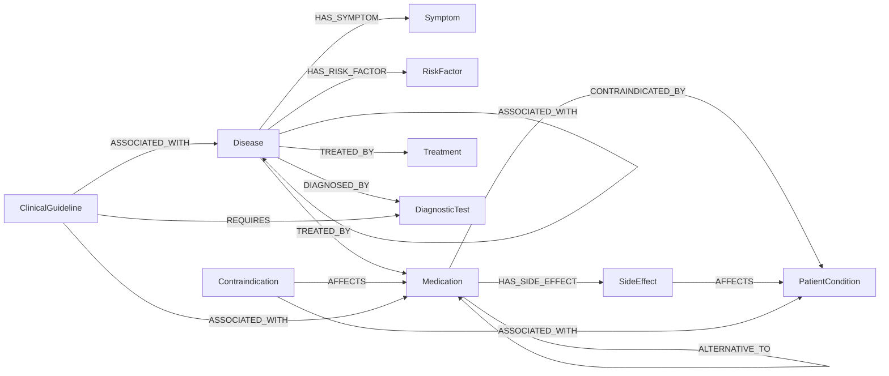

# Clinical Knowledge-Graph Ontology

> Synthetic, educational ontology. Not medically authoritative. The executable version is `src/ontology.py`;
> every triple loaded into Neo4j / NetworkX is validated against it (`validate_triple`).


## Entity classes

| Class | Meaning | Example (synthetic KB) |
|---|---|---|
| `Disease` | Clinical condition | Hypertension |
| `Symptom` | Reported manifestation | Headache |
| `Medication` | Fictional drug | Cardivex |
| `Treatment` | Non-drug intervention | Low-Sodium Diet |
| `RiskFactor` | Raises disease likelihood | Obesity |
| `DiagnosticTest` | Test / examination | Serum Creatinine Test |
| `SideEffect` | Adverse effect of a medication | Dry Cough |
| `PatientCondition` | Patient state modifying suitability | Pregnancy |
| `Contraindication` | *Reified* record (severity + rationale) of a restriction | "Cardivex contraindicated in Pregnancy" |
| `ClinicalGuideline` | Guideline snippet linking entities to required tests | ACE-Inhibitor-Like Renal Monitoring Guideline |

## Relations (domain -> range)

| Relation | Allowed (domain -> range) | Example |
|---|---|---|
| `HAS_SYMPTOM` | Disease -> Symptom | Hypertension -> Headache |
| `HAS_RISK_FACTOR` | Disease -> RiskFactor | Hypertension -> Obesity |
| `TREATED_BY` | Disease -> Medication / Treatment | Hypertension -> Cardivex |
| `CONTRAINDICATED_BY` | Medication / Treatment -> PatientCondition | Cardivex -> Pregnancy |
| `HAS_SIDE_EFFECT` | Medication -> SideEffect | Cardivex -> Dry Cough |
| `DIAGNOSED_BY` | Disease -> DiagnosticTest | Heart Failure -> Echocardiogram |
| `ASSOCIATED_WITH` | Disease -> Disease; ClinicalGuideline -> Disease / Medication; Contraindication -> PatientCondition | Hypertension -> Chronic Kidney Disease |
| `AFFECTS` | SideEffect -> PatientCondition; Contraindication -> Medication | Hyperkalemia -> Severe Renal Impairment |
| `REQUIRES` | ClinicalGuideline -> DiagnosticTest | Diuretic Hydration Guideline -> Serum Creatinine Test |
| `ALTERNATIVE_TO` | Medication -> Medication | Diurex -> Cardivex |

Modelling notes:

* `CONTRAINDICATED_BY` is a **direct edge** (used for fast traversal and by rule R01) *and* is reified as a `Contraindication`
  node carrying severity and rationale (`Contraindication -AFFECTS-> Medication`, `Contraindication -ASSOCIATED_WITH-> PatientCondition`).
  The same rationale is stored as the `note` property on the direct edge.
* `ALTERNATIVE_TO` is stored in one direction but treated as symmetric by traversal and rule R04.
* Names are globally unique, so `name` is the node key (uniqueness constraint per label in Neo4j).

## Mermaid view



## Worked multi-hop example

```
Heart Failure -[TREATED_BY]-> Diurex -[HAS_SIDE_EFFECT]-> Dehydration -[AFFECTS]-> Severe Renal Impairment
```
A 3-edge chain that no single document states: the disease page lists Diurex, the Diurex monograph lists Dehydration, and the
side-effect concern appears only in the monograph's own sentence about patient conditions.

## Why the ontology is useful for structured reasoning

1. **Typed, constrained data.** Domain/range constraints reject malformed facts at load time (`Symptom -TREATED_BY-> Disease` is impossible), so rules can rely on the shape of the graph.
2. **Rules are written against classes, not instances.** "Medication CONTRAINDICATED_BY PatientCondition" is one rule for every drug.
3. **Traversal policy lives in one place.** Which relations may be walked backwards (`INVERSE_TRAVERSAL`) is an ontology property, not retriever code.
4. **Linking and explanation.** Types decide which entities the linker may match (`LINKABLE_TYPES`) and let the UI explain *why* each hop was taken.
5. **Extensibility.** New classes (e.g. `Procedure`) or relations only need a schema entry plus data - the retriever and rule engine are unchanged.
